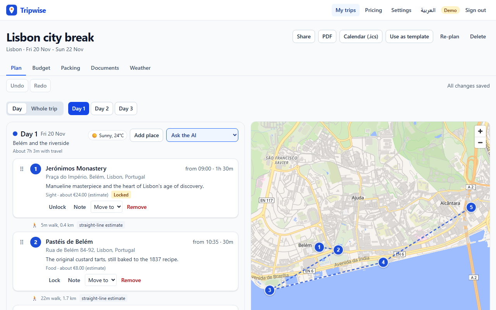
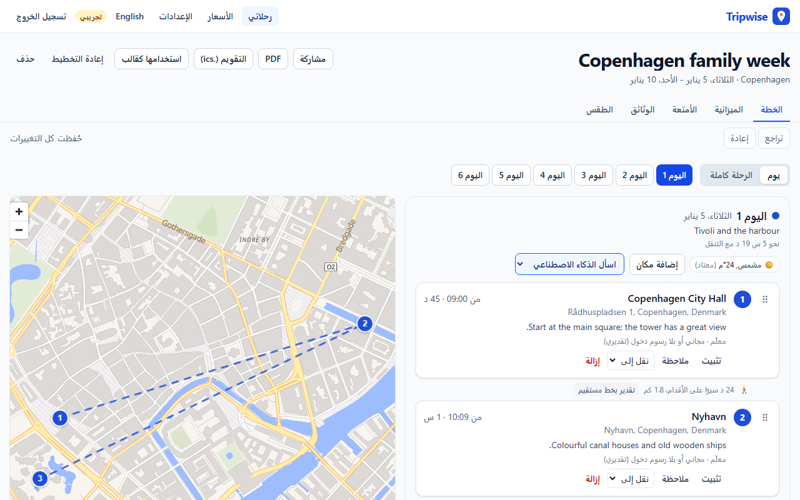
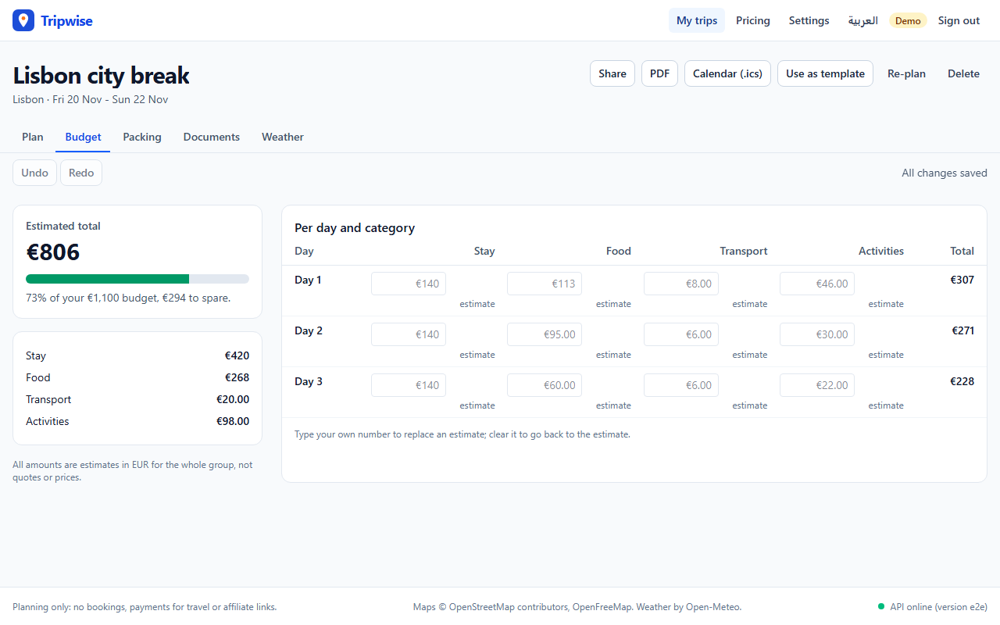
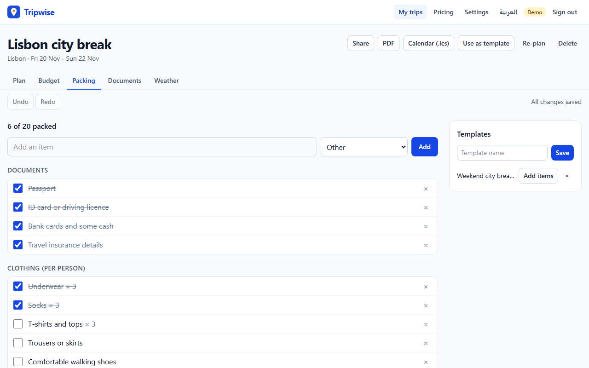
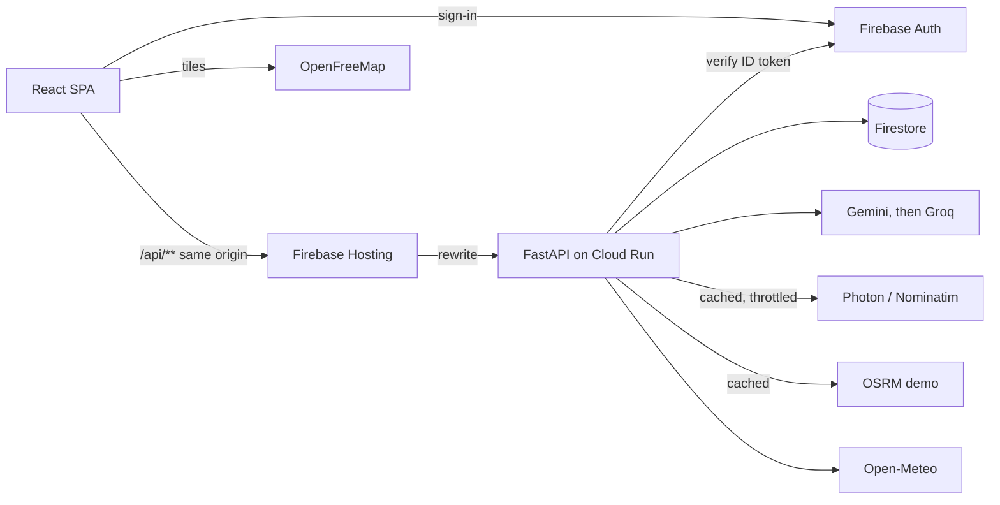
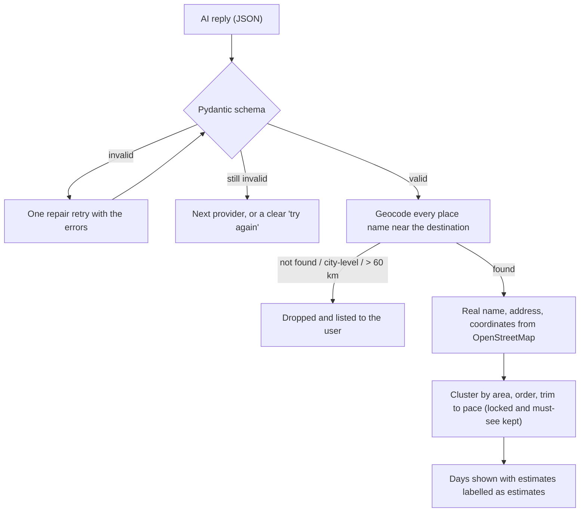

# Tripwise

**Plan a trip in minutes.** A short wizard, an AI-built day-by-day itinerary on a map, a budget,
a packing list and a documents checklist: all editable, saved and shareable.

**Live demo:** <https://tripwise-plan.web.app> (click **Try the demo**: no sign-up, a private
account with two sample trips).


_Recorded with the offline fake AI and geocoder used in tests, so place names are placeholders. The
live site uses OpenStreetMap, and Gemini with Groq as fallback once their API keys are configured._

| Itinerary on the map                                                         | Arabic, right to left                                          |
| ---------------------------------------------------------------------------- | -------------------------------------------------------------- |
|  |  |
|                         |          |

## Why it is more than an AI chat

- **Real places only.** The AI suggests names; every one is looked up on OpenStreetMap before
  it is shown. Addresses and coordinates come from the geocoder, never from the AI, and anything
  that cannot be found is left out and listed.
- **A plan on a map.** Days are grouped by area and ordered to keep travel short, with travel
  times between stops (road routes from OSRM where it helps, labelled straight-line estimates
  otherwise).
- **Edit by dragging.** Reorder stops, move them between days, lock favourites, add places by
  search. Every change can be undone.
- **Ask the AI about one day.** "Make it more relaxed", "add a rainy-day option", "more local
  food", "cheaper": the answer is a diff you accept or reject, as one undoable step. Locked
  stops always survive.
- **Everything for the trip in one place.** Budget per day and category with a meter and your
  own overrides, a rule-based packing list with templates, a documents checklist with dates and
  notes, and the weather.

Planning only: no bookings, payments for travel or affiliate links. Visa and entry rules are
links to official government sources, never answers.

## Features

| Area             | What you get                                                                                                                                                                                                                                                          |
| ---------------- | --------------------------------------------------------------------------------------------------------------------------------------------------------------------------------------------------------------------------------------------------------------------- |
| Wizard           | Destinations (up to 3) → dates or number of days → travellers → budget and currency → interests → pace → needs (mobility, diet, must-sees) → review. One question per screen, progress bar, Back keeps answers, inline validation.                                    |
| Itinerary        | Day view and whole-trip view, synced with a MapLibre map: numbered stops coloured per day, route lines, estimated times.                                                                                                                                              |
| Editing          | Drag and drop (mouse, touch, keyboard), move to another day, add by search, remove, lock, notes, rainy-day options, undo/redo (Ctrl+Z), autosave with conflict detection.                                                                                             |
| AI               | Gemini (free tier) with Groq as fallback when Gemini's daily quota runs out. Strict JSON validated by Pydantic, one repair retry, then grounding.                                                                                                                     |
| Budget           | Stay, food, transport and activities per day, against the wizard budget, with your own numbers replacing any estimate.                                                                                                                                                |
| Essentials       | Packing list from destination climate, season, length, interests and travellers; checkable, editable, reusable as a template. Documents checklist with due dates and notes. Weather from Open-Meteo (forecast within 16 days, last year's dates otherwise, labelled). |
| Share and export | Revocable read-only link (no sign-in to view). PDF itinerary with a map snapshot. `.ics` calendar. Duplicate a trip as a template.                                                                                                                                    |
| SaaS shell       | Google sign-in and the demo account. Free (3 trips, 20 AI requests a day) and Pro (unlimited trips, 100 a day) with Stripe Checkout in test mode. Settings: profile, home currency, units, language, delete account and data.                                         |
| Quality          | English and Arabic with full right-to-left layout, phone-first layouts, WCAG 2.2 AA checks with axe in both languages, loading, empty and error states everywhere.                                                                                                    |

## Architecture



More in [docs/architecture.md](docs/architecture.md).

## How AI output is validated and grounded



The AI's schema has no coordinate, address, price or opening-hours fields at all; durations and
costs are estimates and the UI says so. The grounding code and its tests are in
[api/src/tripwise_api/planning](api/src/tripwise_api/planning) and
[api/tests/test_grounding.py](api/tests/test_grounding.py).

## Key decisions

| Decision                                              | Why                                             | ADR                                                         |
| ----------------------------------------------------- | ----------------------------------------------- | ----------------------------------------------------------- |
| Monorepo: `web`, `shared`, `api`, `firebase`, `e2e`   | Contract and domain change together             | [0001](docs/adr/0001-monorepo-and-tooling.md)               |
| FastAPI on Cloud Run behind a Hosting rewrite         | No sleeping free tier, one origin, one bill     | [0002](docs/adr/0002-cloud-run-behind-firebase-hosting.md)  |
| Gemini first, Groq fallback, fake provider offline    | Free tiers with a fallback; CI needs no keys    | [0003](docs/adr/0003-gemini-with-groq-fallback.md)          |
| Pydantic models generate the TypeScript types and Zod | One source of truth, checked in CI              | [0004](docs/adr/0004-pydantic-as-schema-source.md)          |
| One document per trip, writes only through the API    | Atomic edits that match undo steps              | [0005](docs/adr/0005-trip-document-and-api-writes.md)       |
| Anonymous demo accounts seeded atomically             | Try everything in seconds, privately            | [0006](docs/adr/0006-auth-demo-and-limits.md)               |
| Grounding and usage policies                          | No invented places; respectful use of free APIs | [0007](docs/adr/0007-grounding-and-third-party-policies.md) |
| Print-to-PDF, `.ics`, Stripe test mode                | Correct Arabic in PDFs; no real payments        | [0008](docs/adr/0008-exports-and-billing.md)                |

Everything decided without an explicit instruction is listed in
[docs/assumptions.md](docs/assumptions.md).

## Stack

React 19, TypeScript (strict), Vite, Tailwind CSS v4, React Router, TanStack Query, Zustand,
React Hook Form + Zod, MapLibre GL JS, dnd-kit, i18next · Python 3.12, FastAPI, Pydantic, uv ·
Firestore, Firebase Auth, Firebase Hosting, Cloud Run · Vitest, Testing Library, Playwright,
axe, pytest · GitHub Actions with keyless deploys (Workload Identity Federation).

## Repository

```
web/        React SPA (features/: wizard, itinerary, map, budget, packing, documents, ...)
shared/     generated API types and Zod schemas, plus pure TypeScript domain logic:
            edit operations, undo/redo history, day diff, budget, schedule, travel, .ics
api/        FastAPI service
  domain/     pure Python: clustering, ordering, pace, packing and documents rules, limits
  planning/   AI models and prompts, grounding, generation, day edits
  integrations/ geocoders, routing, weather, caches, throttles
firebase/   Firestore rules, indexes and their emulator tests
e2e/        Playwright tests (desktop and phone), including axe accessibility checks
infra/      one-time Google Cloud setup and secrets scripts
docs/       architecture, decisions (adr/), assumptions, deploy guide
```

## Run locally

Requires Node 22, pnpm 10, [uv](https://docs.astral.sh/uv/), and Java 21 for the emulators.

```sh
pnpm install
uv sync --directory api
cp api/.env.example api/.env     # fake AI and places, pointed at the emulators
pnpm emulators                   # terminal 1: Auth and Firestore emulators
pnpm dev:api                     # terminal 2: API on :8000
pnpm dev:web                     # terminal 3: app on :5173
```

With `AI_PROVIDERS=gemini,groq`, `PLACES_PROVIDER=osm` and keys in `api/.env`, the same setup
uses the real AI and OpenStreetMap services.

## Tests

| Command                                                             | What runs                                                                                                       |
| ------------------------------------------------------------------- | --------------------------------------------------------------------------------------------------------------- |
| `pnpm test`                                                         | Vitest: shared domain logic and web components                                                                  |
| `uv run pytest` (in `api/`)                                         | Domain logic, AI validation and grounding, routes, billing, integrations                                        |
| `pnpm test:rules`                                                   | Firestore security rules on the emulator                                                                        |
| `pnpm test:e2e`                                                     | Playwright on desktop and phone with emulators: demo, wizard, AI edit, share, essentials, axe in both languages |
| `pnpm lint`, `pnpm typecheck`, `uv run ruff check .`, `uv run mypy` | Static checks (strict)                                                                                          |

## Deploy

Pushes to `main` deploy after CI passes: API to Cloud Run (max 2 instances), then Hosting and
Firestore rules, each followed by a smoke test. One-time setup, AI keys and Stripe test keys are
described in [docs/deploy.md](docs/deploy.md).

## License

[MIT](LICENSE)
