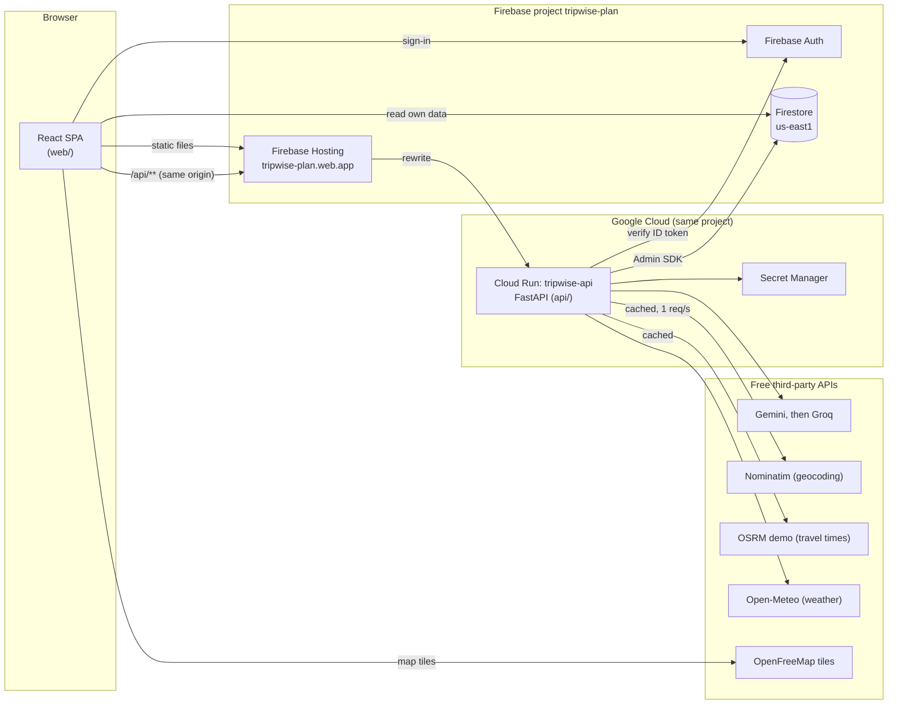

# Architecture

## Request path

1. The browser loads the SPA from Firebase Hosting.
2. API calls go to `/api/...` on the same origin. Hosting forwards them to Cloud Run, path intact.
3. Every API route except `/api/health` requires a Firebase ID token (`Authorization: Bearer`),
   verified with the Admin SDK (`api/src/tripwise_api/auth.py`).

## AI validation and grounding

An AI answer reaches the user only after every step passes (ADR 0007):

1. **Schema**: the provider gets the JSON Schema of the Pydantic model; the reply is parsed by
   Pydantic again, with one repair retry that quotes the validation errors.
2. **Geocoding**: each suggested place is resolved through Photon (Nominatim as fallback). Only
   specific places within 60 km of the destination survive; the AI never supplies coordinates
   or addresses.
3. **Sanity checks**: duplicates are dropped, days are regrouped by area, ordered, and trimmed to
   the pace; locked and must-see stops are protected. Locked stops also survive AI day edits.
4. **Labels**: durations, costs and travel times are labelled as estimates; visa rules are links
   to official sources.

## Where the logic lives

| Logic                                                                            | Location                        | Tests                                            |
| -------------------------------------------------------------------------------- | ------------------------------- | ------------------------------------------------ |
| Clustering, ordering, pace, packing and documents rules, plan limits             | `api/src/tripwise_api/domain`   | `api/tests/test_domain_*.py`                     |
| AI models, prompts, grounding, generation, day edits                             | `api/src/tripwise_api/planning` | `api/tests/test_grounding.py`, `test_ai_edit.py` |
| Edit operations, undo/redo, day diff, budget, schedule, travel estimates, `.ics` | `shared/src/domain`             | `shared/src/domain/*.test.ts`                    |
| Itinerary store and autosave                                                     | `web/src/features/itinerary`    | `itinerary.test.tsx`                             |

## Phase status

All ten phases of the build order are implemented; see the README for the feature list.
