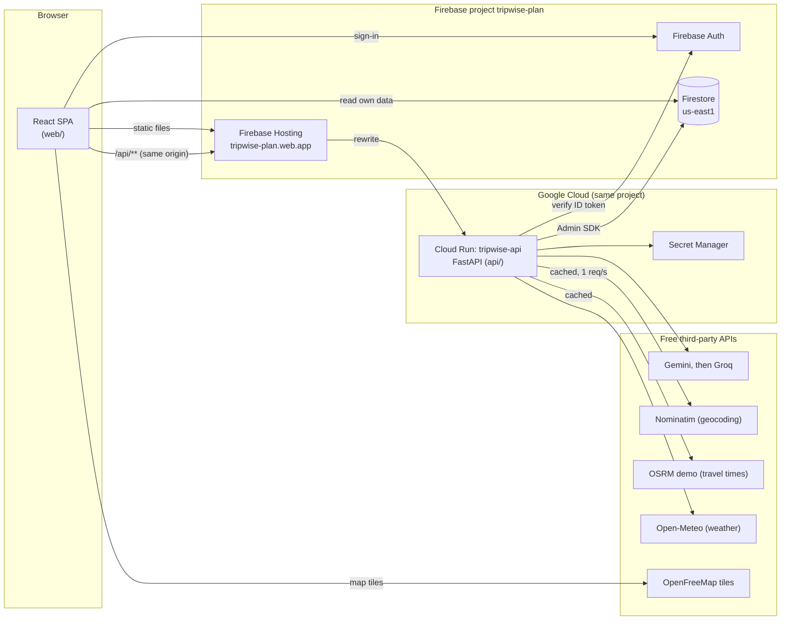

# Architecture

## Request path

1. The browser loads the SPA from Firebase Hosting.
2. API calls go to `/api/...` on the same origin. Hosting forwards them to Cloud Run, path intact.
3. Every API route except `/api/health` requires a Firebase ID token (`Authorization: Bearer`),
   verified with the Admin SDK (`api/src/tripwise_api/auth.py`).

## AI validation and grounding (phase 3)

An AI answer reaches the user only after every step passes:

1. **Schema**: the provider is asked for JSON matching the Pydantic model; the reply is parsed by
   Pydantic again and rejected on any mismatch.
2. **Geocoding**: each suggested place is resolved through the geocoder. Unresolved places are
   dropped or flagged; the AI's own coordinates and addresses are never shown.
3. **Sanity checks**: places must lie near the destination, and a day must fit the chosen pace.
4. **Labels**: durations and costs are shown as estimates; visa rules only as links to official
   sources.

## Phase status

| Phase | Scope                                                  | Status      |
| ----- | ------------------------------------------------------ | ----------- |
| 1     | Monorepo, tooling, CI, Firebase config, deployed shell | Built       |
| 2-10  | See the build order in the README                      | Not started |
